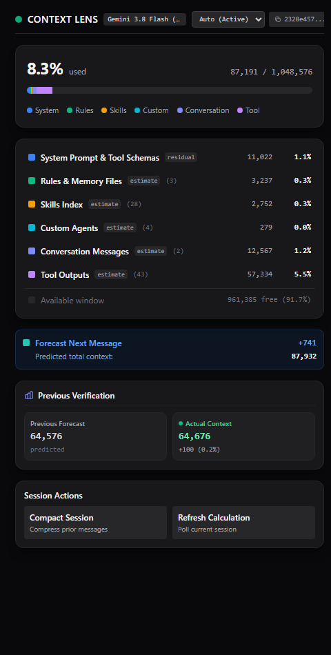

# Context Lens

[](https://antigravity.google)
[](https://nodejs.org)
[](#)
[-blue.svg)](#)
[](#security--architecture)
[](LICENSE)

> Real-time context window usage breakdown, token allocation HUD, and next-message forecast for Google Antigravity Desktop sessions. Requires **Antigravity Desktop 2.24.0 or later**.

---

## Why Context Lens?

**Antigravity Desktop does not have a built-in context window monitor as of now.**

When your conversation gets long and nears the model's token capacity, Antigravity triggers an automatic background compaction (`autocompact`). This summarizes your entire chat history in one blunt pass, frequently losing critical nuance, architectural decisions, and specific code context you needed to keep.

**Context Lens solves this problem.** It gives you live, estimated context telemetry and predictive next-turn forecasting in your side panel. With clear visibility into how much headroom you have left, **you decide when to run `/compact` proactively**—allowing you to explicitly instruct the agent on which details, constraints, and files to preserve instead of leaving it to an unguided auto-summary.

---

## Preview

<p align="center">
  
</p>

---

## Features

- **Live Auxiliary HUD**: Opens directly in Antigravity's auxiliary side pane (`sidecar://context-lens/lens/`).
- **Segmented Capacity Bar**: Visualizes used vs. available tokens relative to model-specific context limits (Gemini 2.5/3/3.8/4, Claude Sonnet/Opus, etc.), with an optional autocompact threshold marker.
- **Granular Token Breakdown**:
  - **Conversation Turns**: User prompts and assistant responses over time.
  - **Rules & Directives**: Active system instructions and project `AGENTS.md` rules.
  - **Skills**: Injected skill runbooks and metadata.
  - **Subagents & Tools**: Tool declarations, schemas, and subagent prompts.
  - **Cache Reads vs. Fresh Input**: Clear distinction of cached tokens vs. new input.
- **Next-Message Forecast Engine**: Real-time projection predicting total context consumption on your next prompt, backed by walk-forward MAPE (Mean Absolute Percentage Error) accuracy verification.
- **Session Switcher**: Follow the active session automatically or switch focus to inspect recent conversation sessions.
- **100% Self-Contained & Offline-Ready**: Zero external CDN dependencies (all UI styles inlined). Functions fully in air-gapped or restricted enterprise networks.
- **Zero External Dependencies**: Pure native Node.js ES modules. Runs out of the box with zero `npm install` packages.

---

## Requirements

- **Google Antigravity Desktop 2.24.0 or later.** 2.24.0 is the version Context Lens was tested on. Sidecars are only available in the Antigravity App, not in the Antigravity IDE or CLI.
- **Node.js v20.4 or later on your `PATH`.** The sidecar starts with the `node` command; Antigravity does not bundle Node.js.

> [!IMPORTANT]
> **Older sessions show no data.** Context Lens reads the token counts (`input_tokens`, `cache_read_tokens`, `output_tokens`) that Antigravity writes for each model response. Sessions created by Antigravity builds older than 2.24.0 may not record these counts. For those sessions the HUD stays on "Waiting for first model response telemetry". Update Antigravity and start a new session to see data.
>
> **Context Lens depends on undocumented Antigravity internals.** It reads session transcripts from `~/.gemini/antigravity/brain/<conversation-id>/.system_generated/logs/transcript_full.jsonl` and uses the sidecar web UI APIs (`sidecar_sdk`, `window.sidecar`). None of these are in the official Antigravity documentation. They were observed in Antigravity Desktop 2.24.0. A future Antigravity update may change them and break Context Lens.

---

## Platform Support

| Platform | Status |
|---|---|
| Windows 11 | Tested with Antigravity Desktop 2.24.0. |
| macOS | Not tested. The code is portable, but see the notes below. |
| Linux | Not tested. The code is portable, but see the notes below. |
| Googlebook | Not tested. |

The code uses only `node:path`, `node:fs` and `os.homedir()`, with no native modules and no platform-specific commands. On macOS and Linux it assumes Antigravity uses the same `~/.gemini/antigravity/brain` layout as on Windows, which is not documented.

**macOS tip:** apps launched from the Dock or Finder may not see a `node` installed through Homebrew or nvm. If the side pane stays blank, make sure `node` is available system-wide (for example, the installer from [nodejs.org](https://nodejs.org)).

---

## Security & Architecture

- **Content Security Policy (CSP)**: Served with `default-src 'self'` and `connect-src 'self'`, so the page cannot load or send anything outside the sidecar. Inline scripts and styles are allowed (`'unsafe-inline'`) because the HUD is a single self-contained HTML file. Also sends `X-Content-Type-Options: nosniff` and `Referrer-Policy: no-referrer`.
- **Unobtrusive DOM Event Model**: No inline event handlers (`onclick`); standard event listeners and data-attribute delegation instead. All rendered text is HTML-escaped.
- **Directory Traversal Protection**: Conversation IDs are restricted to `[a-zA-Z0-9_-]` and checked against a strict path prefix (case-insensitive on Windows).
- **Denial-of-Service Defense**: Enforces a 50MB safety limit on transcript parsing to prevent memory exhaustion on giant log files.
- **Privacy Path Redaction**: Your home directory is shown as `~` in session locations.
- **Caching**: In-memory LRU/TTL caching (with 3-second caching of session listings) avoids re-reading files on every poll.

---

## Installation

### Method 1: Ask Your Antigravity Agent

Copy and paste this prompt into your Antigravity chat:

```text
Install this plugin from https://github.com/danilofaugusto/context-lens and configure it to be available globally.
```

Your agent will clone the repository into `~/.gemini/config/plugins/context-lens` and guide you to restart Antigravity.

---

### Method 2: Global Git Clone (Manual)

Clone this repository into your global Antigravity plugins directory:

#### Linux / macOS
```bash
git clone https://github.com/danilofaugusto/context-lens.git ~/.gemini/config/plugins/context-lens
```

#### Windows (PowerShell)
```powershell
git clone https://github.com/danilofaugusto/context-lens.git "$HOME\.gemini\config\plugins\context-lens"
```

*Restart Antigravity after cloning.*

---

### Method 3: Team / Project-Specific (`.agents/plugins/`)

To bundle Context Lens for all collaborators in a specific repository:

1. Clone or copy it into your project's `.agents/plugins/` directory:
   ```bash
   git clone https://github.com/danilofaugusto/context-lens.git .agents/plugins/context-lens
   ```
2. Commit `.agents/plugins/context-lens` into Git.
3. Teammates get the plugin when they open the workspace, with no individual setup.

---

## Usage

### For Humans

1. Open Antigravity Desktop.
2. In the chat, run any of these prompts:
   - `"Open Context Lens"`
   - `"Show context breakdown for this session"`
   - Or click the sidecar link directly: `[Open Context Lens](sidecar://context-lens/lens/)`
3. The Context Lens dashboard appears in the auxiliary side pane.

### For AI Agents

When assisting in a session where `context-lens` is installed:
- **Navigation**: Provide the user with the direct sidecar link whenever token usage, context limits, or compaction are discussed:
  ```markdown
  [Open Context Lens](sidecar://context-lens/lens/)
  ```
- **Proactive Compaction Advice**: Check context health before large multi-file operations. If usage exceeds 70% of window capacity, remind the user to trigger a selective `/compact` to retain critical architectural decisions.

---

## Configuration

Customize context window targets and paths in `sidecars/lens/lens.config.json`:

```json
{
  "defaultWindow": 1048576,
  "windows": {
    "Gemini 4": 1048576,
    "Gemini 3.8": 1048576,
    "Gemini 3": 1048576,
    "Gemini 2.5": 1048576,
    "Claude Opus 5.5": 1000000,
    "Claude Opus": 1000000,
    "Claude Sonnet": 200000,
    "Claude Haiku": 200000
  },
  "workspaceDirs": [],
  "autocompactThreshold": null,
  "brainDir": null
}
```

- `defaultWindow`: Fallback token capacity if the active model cannot be detected.
- `windows`: Model name to token limit mapping. The longest name contained in the active model's name wins.
- `workspaceDirs`: Extra workspace folders to scan for `AGENTS.md`, `GEMINI.md` and `.agents/rules/*.md`, used when Antigravity does not report the open workspace.
- `autocompactThreshold`: Optional marker on the usage bar. A value up to `1` is a fraction of the window (for example `0.8`); a larger value is a token count. `null` hides it.
- `brainDir`: Explicit path override for Antigravity conversation storage (defaults to `~/.gemini/antigravity/brain`).

---

## Directory Structure

```text
context-lens/
├── plugin.json                    # Antigravity plugin manifest
├── README.md                      # Documentation
├── LICENSE                        # MIT license
├── .gitignore
├── assets/
│   └── context-lens-hud.png       # Preview screenshot
├── skills/
│   └── context-lens/
│       └── SKILL.md               # Agent skill definition & sidecar link
└── sidecars/
    └── lens/
        ├── sidecar.json           # Sidecar registration for auxiliary pane
        ├── lens.config.json       # Window thresholds & model definitions
        ├── package.json           # Native ESM manifest
        ├── server.mjs             # Sidecar HTTP server & API endpoints
        ├── index.html             # Real-time HUD interface
        ├── lib/
        │   ├── parse.mjs          # Session transcript parser
        │   ├── scan.mjs           # Rules, skills & agent scanner
        │   ├── breakdown.mjs      # Token categorization engine
        │   ├── forecast.mjs       # Next-turn predictor & backtester
        │   ├── stats.mjs          # Response assembly for the HUD
        │   ├── paths.mjs          # Safe conversation path resolution
        │   └── cache.mjs          # In-memory LRU/TTL caching
        └── test/
            ├── audit-bugs.test.mjs
            ├── audit-fixes.test.mjs
            ├── breakdown.test.mjs
            ├── forecast.test.mjs
            ├── parse.test.mjs
            ├── paths-cache.test.mjs
            ├── proposed-bugs.test.mjs
            ├── proposed-strength.test.mjs
            ├── scan.test.mjs
            ├── stats.test.mjs
            └── verify-invariants.test.mjs
```

---

## Development & Testing

Context Lens uses the native Node.js test runner (`node:test`). No external test packages required.

```bash
cd sidecars/lens
npm test
```

The tests cover the `lib/` modules. `server.mjs` imports `sidecar_sdk`, which only exists inside Antigravity, so it is not covered by the test suite.

---

## License

[MIT](LICENSE)
